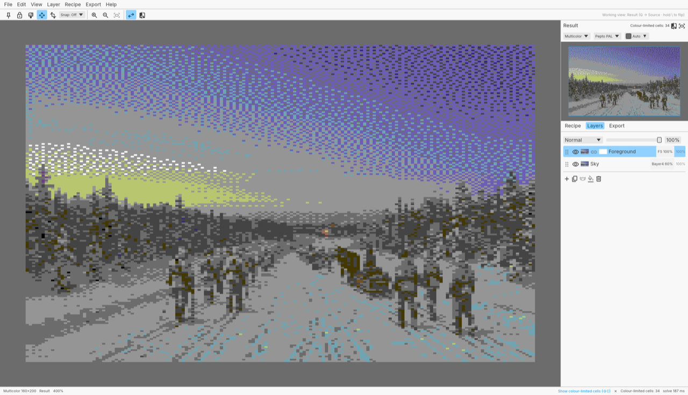
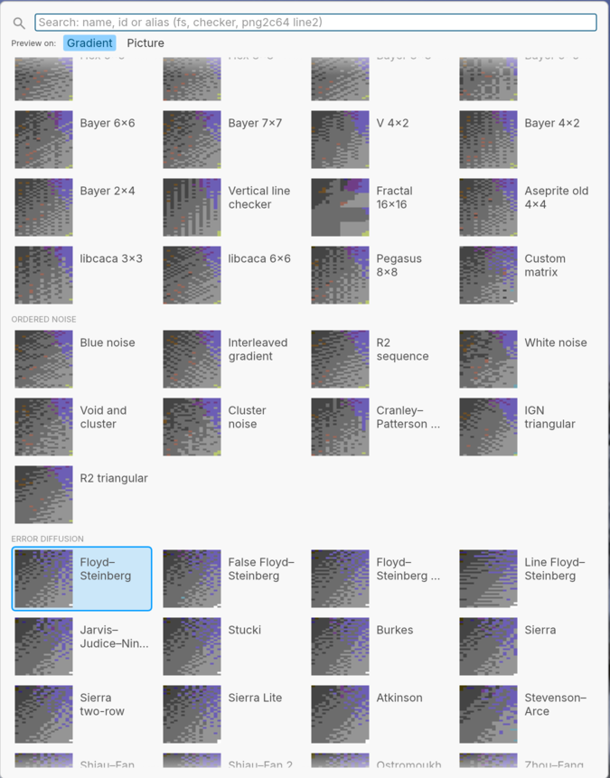
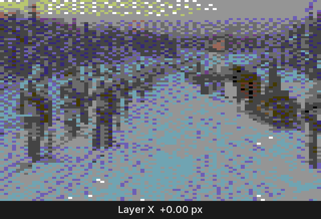
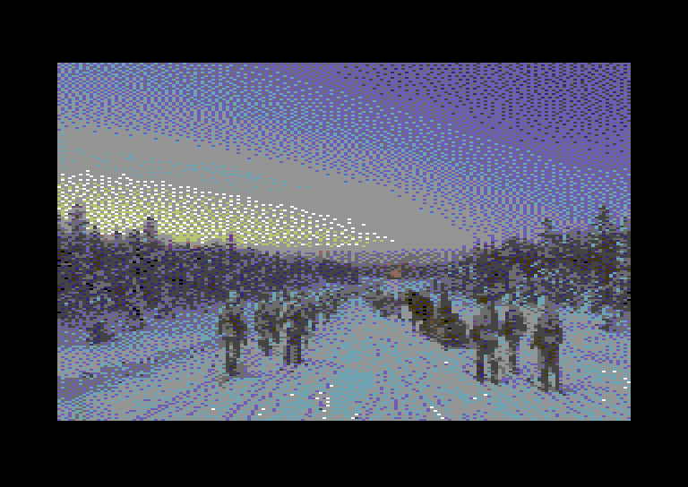

# Convert64

**A layered, high-precision image converter whose only output is legal Commodore 64 graphics.**

Edit in 16-bit/float across multiple layers — nudge them sub-pixel, mask and feather them, adjust levels/hue/saturation per layer, give *each layer its own dithering recipe* — and watch an accurate VIC-II preview re-solve as you drag. Then export straight to Koala, Art Studio, charsets, sprites, raw binaries or assembler source for KickAssembler, ACME, 64tass and ca65.

> Convert64 is a **converter**, not a pixel editor. Everything that steers *conversion* is in scope (cell colour pins, cell locks, per-region dither/metric overrides, Force vs Adaptive colour fitting). Freehand pixel painting is not — hand the result to Pixcen, Multipaint, CharPad, SpritePad or ArcPaint64 for touch-ups.

**Status:** pre-alpha, planning complete, scaffolding in progress. Nothing runs yet. See [docs/PDD.md](docs/PDD.md) and [docs/TAD.md](docs/TAD.md).

---

## Why

Every existing converter (retropixels, png2c64, C64CC, editor importers) treats conversion as **one global operation on one flattened image**: pick a palette, pick a dither, press go — then fix the result pixel by pixel. The step *between* source art and pixel editor is missing: the step where you say

- "the sky gets ordered 4×4 dither at 60 %, the face gets Floyd–Steinberg at 100 %, the rifle gets none",
- "nudge the face layer 0.5 px so the eye lands in a cell that can afford a third colour",
- "feather the fog layer over 6 px so the dither fades instead of cutting",

…and see the real C64 result (right palette, colour clashes resolved, 2:1 pixel aspect) update live.

## In pictures

All of these use the `title` test picture from [fixtures/title](fixtures/title/README.md); [docs/media/make-media.sh](docs/media/make-media.sh) regenerates them.

**Per-layer dithering.** The picture twice: the *Sky* layer with ordered Bayer 4×4 at 60 %, the *Foreground* copy with Floyd–Steinberg at 100 %, masked to below the tree line by a gradient. One solve gives one legal multicolor picture.

<picture>
  <source media="(prefers-color-scheme: dark)" srcset="docs/media/per-layer-dithering-dark.png">
  
</picture>

**The method picker.** Every dither method as a live thumbnail, solved on a test gradient (as here) or on the layer's own picture, with search by name, id or alias.

<picture>
  <source media="(prefers-color-scheme: dark)" srcset="docs/media/method-picker-dark.png">
  
</picture>

**Sub-pixel nudge.** The layer moved right in 0.25 px steps (a multicolor pixel is 2 px wide) and back; every step re-solves and the dither falls differently. Shown at 4× (each multicolor pixel 8 × 4).



**In VICE.** `convert64 convert fixtures/title/source.png -o title.kla -o title.prg`, then the self-displaying PRG (the same Koala data behind a small viewer) in `x64sc`. VICE's screen matches Convert64's preview on all 64 000 pixels.



## How it works (short version)

```
layers (f32 linear RGBA, float transforms, masks, feather, adjustments, dither recipe)
   → composite at N× supersample + per-pixel "attribute map" (which recipe governs each pixel)
   → resample to the target grid (320×200 hi-res or 160×200 multicolor, 2:1 aspect)
   → constraint solver (global colours → per-cell colour sets → cell-clamped dithering → refine)
   → validated C64 image model
       → preview (Pepto / Colodore palette, border, aspect)
       → exporters (.kla .art .spd raw .bin .prg .asm .h .png + .convert64 project)
```

The key design choice: **dithering is a per-pixel attribute carried through compositing, not an operation performed per layer.** Palette indices cannot be blended, so layers stay in float and only control the *recipe*; one solver pass then produces a globally legal image. Details: [docs/TAD.md](docs/TAD.md), [ADR-002](docs/adr/ADR-002-dither-as-per-pixel-attribute.md).

## Target modes

| Phase | Modes |
|---|---|
| 1 | Multicolor bitmap (Koala), hi-res bitmap (Art Studio) |
| 2 | Hi-res / multicolor / ECM charsets & tiles (256/64-char budget), hi-res / multicolor / overlay sprites |
| 3 | FLI, PAL-blur preview, IFLI/MCI/NUFLI, CharPad `.ctm`, D64 + Ultimate push |

## Architecture

Pure Rust, one cargo workspace:

- `crates/convert64-core` — no I/O: document model, command registry, compositor, attribute map, solvers, validators. Compiles natively and to WASM unchanged.
- `crates/convert64-formats` — byte-exact readers/writers and assembler emitters.
- `crates/convert64-cli` — `convert64` binary for Makefiles and batch work (GUI and CLI have feature parity): [docs/reference/cli.md](docs/reference/cli.md), and [examples/no-glory](examples/no-glory) for a title screen built by `make` from a `.convert64` project.
- `crates/convert64-mcp` — MCP server exposing the same commands to AI agents.
- `crates/convert64-app` — egui/eframe UI; the same code builds the native app (macOS, Windows, Linux) and the browser version.

UX conventions, layout, shortcuts and vocabulary: [docs/UX.md](docs/UX.md). Figma library and how it maps to `egui::Style`: [docs/figma.md](docs/figma.md). Why one command engine behind app, CLI and MCP: [ADR-005](docs/adr/ADR-005-command-engine-with-cli-json-mcp.md). Why egui: [ADR-006](docs/adr/ADR-006-egui-single-rust-workspace.md).

## Roadmap

See [docs/PDD.md §Roadmap](docs/PDD.md#roadmap) and the [epics](docs/github/EPICS.md) / GitHub issues. Milestones: **M0 Scaffold → M1 Bitmap MVP → M2 Charsets & Sprites → M3 Scene features**.

## Building

Not yet — the workspace is being scaffolded (M0). Once it exists:

```sh
cargo run -p convert64-app                  # desktop app
cargo build --release -p convert64-cli      # CLI
cd crates/convert64-app && trunk serve      # browser build
```

## Standing on the shoulders of

- [retropixels](https://github.com/micheldebree/retropixels) (micheldebree, MIT, archived 2026) — documented byte layouts for `.kla`, `.art`, `.spd`, `.fli`.
- [png2c64](https://github.com/tinic/png2c64) (tinic, MIT) — per-cell brute-force search in OKLab, the quality bar we test against.
- [ArcPaint64](https://www.doussis.com/arcpaint64/) (arch0N) — the *Adaptive* vs *Force* colour-fitting vocabulary.
- [C64CC](https://www.elder0010.com/projects/c64cc/) (Elder0010) — GUI + CLI parity for build pipelines; char-budget reuse.
- [ALBERT](https://www.albertpixels.com/) — curves-based adjustment, luminance-weighted distance.
- [PhotoCraft](https://github.com/storytold/photocraft) (storytold, MIT/Apache-2) — a Rust/egui layered editor whose engine-first design (one command registry behind UI, CLI, JSON and MCP), egui widgets and standalone `photocraft-psd` crate we borrow from.
- Palette values: Pepto (Philip Timmermann) and Colodore (pepto.de/projects/colorvic).

First real user: the C64 tactical game *No Glory*.

## Licence

MIT © 2026 Lumi Living Oy. See [LICENSE](LICENSE).
