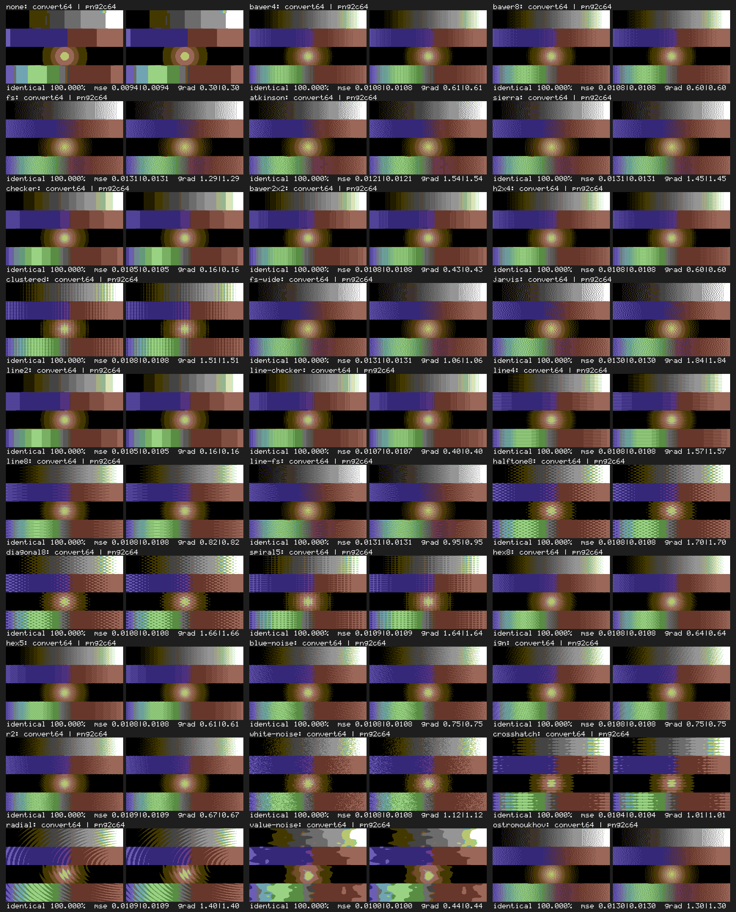
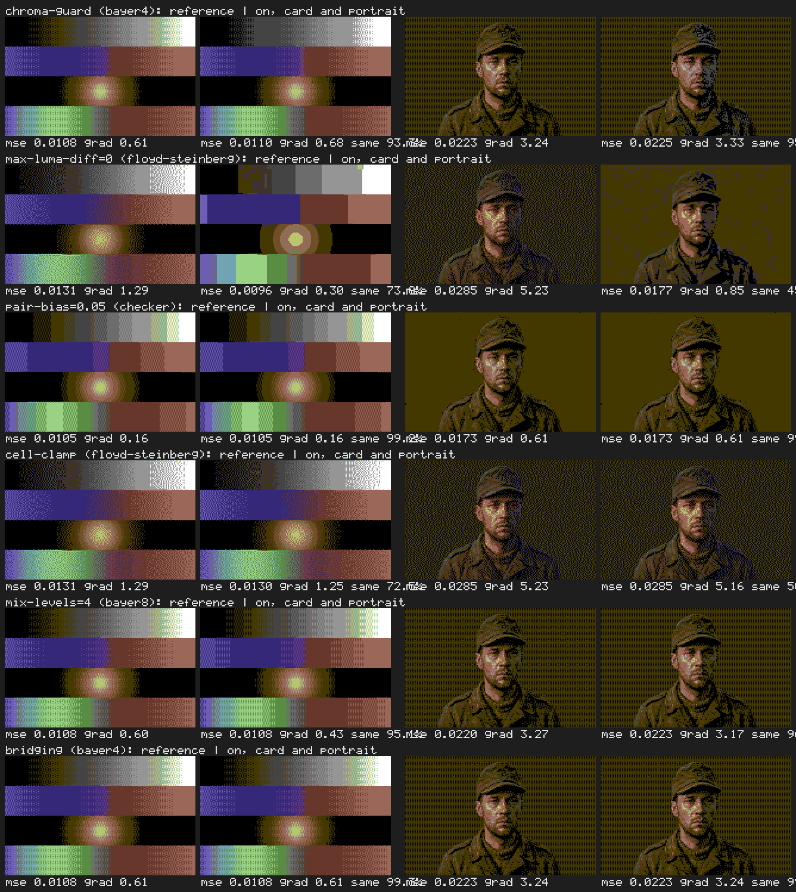

# Dither previews: Convert64 and png2c64

Every dither method rendered on two inputs, multicolor, Pepto palette, so the
look of each method in `dither-methods.md` can be checked without building
anything: png2c64's renders (our reference quality bar) and Convert64's.

## Convert64 side by side with png2c64



[`convert64-sheets/sheet-vs-png2c64.png`](convert64-sheets/sheet-vs-png2c64.png)
pairs ours (left) with png2c64's render (right) on the test card for the 30
methods both have. Since #181 ours is Convert64's default solver, png2c64's
pipeline ported, run on png2c64's own preprocessed card as the parity test runs
it, so every pair is identical by construction; under each pair are the share of
identical pixels, the OKLab MSE against the prepared card and the gradient-domain
error ([`scores.md`](convert64-sheets/scores.md) has them as a table).



[`convert64-sheets/sheet-divergences.png`](convert64-sheets/sheet-divergences.png)
has one row per named divergence of the reference solver (`solve::Divergences`,
all off by default): the reference and the option on, on the card and on the
portrait, with the share of pixels the option leaves unchanged. A divergence
becomes a default only after a human has judged its row.

| File | What |
|---|---|
| `convert64-sheets/sheet-card.png` | all 58 Convert64 methods on the test card (strength 1.0) |
| `convert64-sheets/sheet-zoom.png` | the grey ramp mid-tones of each at 4× |
| `convert64-sheets/sheet-portrait.png` | all 58 on `fixtures/portrait/source.png` (strength 1.0) |
| `convert64-card/`, `convert64-portrait/` | the individual 320×200 renders, named by method id |

The 58-method sheets are the product pipeline (compositor and default solver;
png2c64's 30 methods take the reference, the others the native solver), from the
source with png2c64's preprocessing (gamma 1.5), so they differ from png2c64's
renders by the front end (resampling and where gamma is applied), not the solver.
Regenerate with `cargo xtask dither-sheet --reason "..."` (the reason goes into
[`CHANGELOG.md`](CHANGELOG.md)); `--input <png> --out <dir>` renders any other
picture.

## png2c64's renders

| File | What |
|---|---|
| `testcard.png` | 320×200 synthetic input: grey ramp, colour ramp, radial blob, mixed ramp |
| `sheet-card.png` | all 30 methods on the test card (dither strength 1.0) |
| `sheet-zoom.png` | the grey ramp mid-tones of each method at 4× — pattern structure |
| `sheet-portrait.png` | all 30 methods on `fixtures/portrait/source.png` (png2c64's defaults: strength 1.0) |
| `png2c64-card/`, `png2c64-portrait/` | the individual 320×200 renders |

These renders are the reference of the parity test (#181,
`crates/convert64-core/tests/png2c64_parity.rs`). They come from png2c64 commit
`1265329a` built with strict IEEE arithmetic, the reference build of
[`png2c64-reference.md`](../png2c64-reference.md), and are regenerated, sheets included,
with `cargo xtask png2c64-previews --png2c64 <path>`, which runs:

```
png2c64 --mode multicolor --palette pepto --dither <method> --dither-strength 1.0 card.png <out>
png2c64 --mode multicolor --palette pepto --dither <method> portrait.png <out>
```

The portrait uses png2c64's defaults; its code's default strength is 1.0, although its
`--help` says 0.7. #113 first rendered these with an unrecorded clang 18 build; #181
re-rendered them with the reference build, which changed nine (the diffusion methods and
`none` on the portrait, `ostromoukhov` on the card) and left 51 byte-identical.

Observations worth carrying into E5:
- `radial`, `crosshatch` and `value-noise` are artistic effects, not quantisation aids; keep them, but group them as *Effects* in the recipe, not alongside Bayer.
- `ostromoukhov` is the cleanest diffusion on the ramps (no worms); `atkinson` the most contrasty; `fs-wide`/`jarvis` the softest.
- Line methods show why 2:1 forms matter: `line4`/`line8` cost nothing on multicolor; the vertical variants (ArcPaint64) are not in png2c64 at all.
- `blue-noise`, `ign` and `r2` are nearly indistinguishable at 320×200; one good blue-noise tile covers the family, the others are cheap to keep.
