# Convert64 usability review — browser build, 2026-10-13

**Build:** `main` at the E8 exit plus #201 (`trunk build --release`). **Tested in:** headless Chromium (Playwright), Linux, 1440 × 900 (plus 1280 × 720 and 1024 × 640), dark and light themes. **Method:** expert walkthrough of the UX.md §1 core loop — open → see result → steer (layers, transform, mask, region, pins) → check clashes → export → save — measured against Figma and Photoshop conventions and the ux-designer, ui-designer and form-designer skill checklists. Every finding below was reproduced in the build unless it says otherwise. No real users took part; this replaces nothing in the UX.md §14 test plan, it should go before it.

**Bar:** "on par with commercial image editors and Figma".

## Verdict

The engine is ahead of the interface. Live re-solving, the changed-value dots, the cell right-click menu, toasts and dependable undo are all real strengths. But the first ten minutes contain four things a Figma or Photoshop user would hit and not recover from: the transform corner handles move the layer instead of scaling it, `Tab` hides the whole UI with no way back, a click on the canvas pins a cell, and a page reload throws the project away. Around those sit a red "367 clashes" alarm on a perfectly legal picture, shortcuts that die once you touch a slider, and an export flow that is a list of nine radio buttons.

None of this is deep. The four critical items are a few days of work; C1 and C4 are small code changes (causes below). Fix them before the first user test, or the test will measure these bugs instead of the design.

| | Count |
|---|---|
| Critical (blocks a task or loses work) | 4 |
| Major (users will fail or be misled) | 11 |
| Minor / polish | 9 |

### Heuristic scorecard (1 = poor, 5 = on par with Figma)

| Nielsen heuristic | Score | Why |
|---|---|---|
| Visibility of system status | 3 | Live result, toasts and solve time are good; the clash count says "error" when nothing is wrong |
| Match with the real world | 2 | W/H in % of source pixels, "Ghost of the Other Image", clash as an alarm |
| User control and freedom | 2 | `Tab` trap, Esc doesn't close dialogs, reload loses work; undo itself is solid |
| Consistency and standards | 2 | Corner handles move, labels before vs after controls, browser-reserved shortcuts |
| Error prevention | 2 | Default Pin tool pins on click, Backspace deletes a layer silently |
| Recognition rather than recall | 3 | Tooltips name shortcuts; most icon buttons have no text |
| Flexibility and efficiency | 2 | Shortcuts stop after using any form control |
| Aesthetic and minimalist design | 3 | Clean egui chrome; one long form, red dots over the result |
| Help users with errors | 3 | Toasts are clear; no export or file errors seen to judge |
| Help and documentation | 2 | Help menu is a version label and a link |

---

## Critical

### C1 — Dragging a transform corner moves the layer instead of scaling it

Select the Transform tool, hover a corner handle, drag inward: the layer moves (X −88.67, Y −63.67) and W/H stays at 31.25 %. Reproduced three times, with and without a hover pause first. Edge handles go through the same code path.

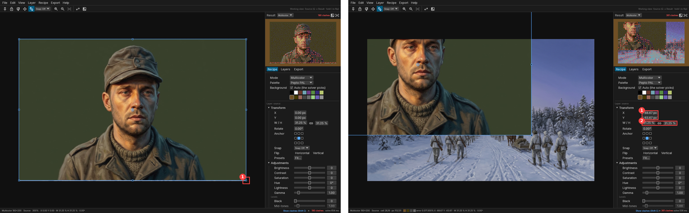

**Cause (code):** `shell/transform.rs:225–227` decides what was grabbed from `response.interact_pointer_pos()` at `drag_started`. egui starts a drag only after the pointer has travelled past its drag threshold, so by then the pointer is already outside the 6 px handle radius and `grab_at` returns `Move`. Use the press origin (`ui.input(|i| i.pointer.press_origin())`) instead.

**Also:** raise the hit radius to 8–10 px (Figma's handles are about 8 px with a larger invisible hit area). Make the initial *Fit* leave a margin; today the layer fills the canvas edge to edge, so at the default zoom the handles sit on the viewport edge (see m1).

**Benchmark:** Figma and Photoshop both scale from corners and edges; that is the expectation for anyone who has used either.

### C2 — `Tab` hides all chrome and nothing brings it back

`Tab` hides the menu bar, toolbar, dock and status bar. A second `Tab`, `Esc`, `Shift Tab`, and a click followed by `Tab` all leave the UI hidden. The only way out was a page reload, which loses the project (C3). The click also pinned a cell (C4).

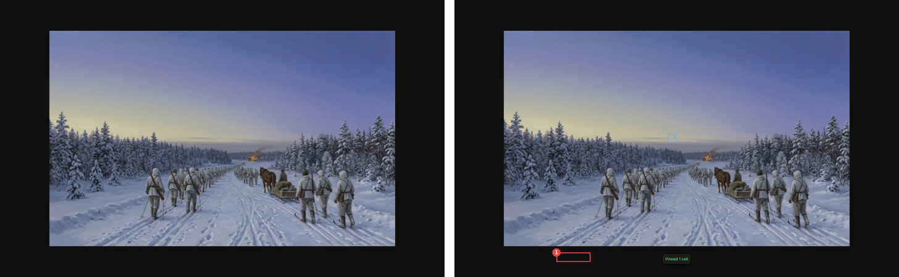

**Why it matters:** this traps a new user within seconds. `Tab` is also the browser's and egui's focus-traversal key, so binding it to "hide everything" breaks the UX.md §12 promise that every control is reachable by `Tab`.

**Fix:**
- Move the shortcut to Figma's `Cmd \` (Show/Hide UI), or keep Photoshop's `Tab` only in the native build.
- `Esc` always restores the UI.
- Show a toast on hide: "UI hidden — press Cmd \ or Esc to show it".

### C3 — Reloading the page loses all work; the browser save flow is unclear

A reload (or an accidental `Cmd R` or `Cmd W`) returned to the empty state. There is no autosave, no restore offer and no "unsaved changes" warning. `Ctrl S` shows rfd's fallback overlay: an unstyled serif link "click here to download your file", plus **Ok** and **Cancel**. Clicking **Ok** showed the toast "Saved source.convert64 (1 817 097 B)", but no download happened in the test browser. Verify this in desktop Chrome; at minimum the toast claimed a save that did not reach the user.

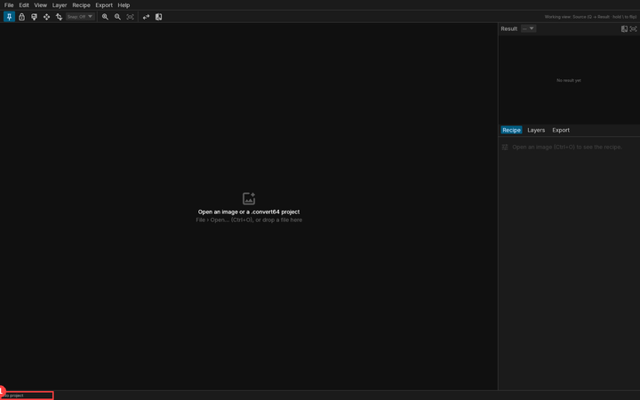

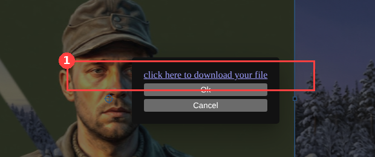

**Benchmark:** Figma autosaves continuously. Photopea warns on leave and keeps recent files in browser storage.

**Fix:**
- Autosave the project to OPFS or IndexedDB on every committed change, and offer "Restore last session" on load.
- Set a `beforeunload` guard while there are unsaved changes.
- Save directly: use `showSaveFilePicker` where available, or an `<a download>` click from the user's own key press. No intermediate overlay.
- Size the toast in human units ("1.8 MB").
- Put the UX.md §9 asterisk in the tab title.

### C4 — The default tool is Pin, so a click on the canvas pins a cell

On first run the Pin tool is selected (toolbar, far left). Any click on the picture — to focus it, to deselect, out of habit — pins that cell. The only feedback is a toast, "Pinned 1 cell", and the pin persists in the project and steers every later solve.

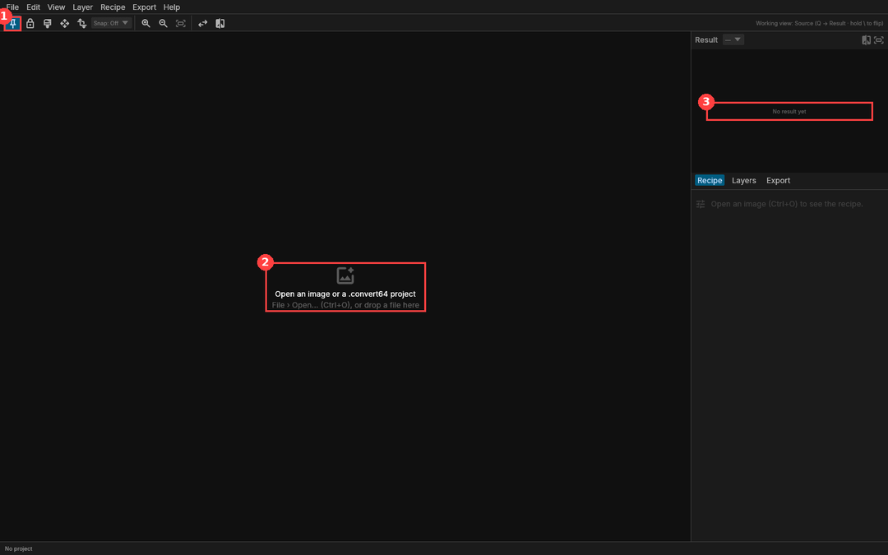

**Benchmark:** Photoshop and Figma both default to Move/Select (`V`), the one tool that cannot change content.

**Fix:**
- Default to Nudge/Move (`V`).
- Pin, Lock and Region apply only after the user picks them.
- Show pins on the canvas immediately (the glyph exists in Result mode).

---

## Major

### M1 — "367 clashes" in red on a picture that is perfectly legal

Opening any photo shows a red clash count, red dots across the result thumbnail, and a red "Show clashes (Shift C)" link. The `title` fixture shows 367; adding the portrait made it 190–381. In the code a clash is a cell where the solver *wanted* more colours than the mode allows and dropped some (`workspace.rs:282`). The output is legal by construction. Every photo will "clash", so the most prominent number in the UI reads as an error the user cannot fix and did not cause.

The red dots also cover the result thumbnail, which is the product's main output.

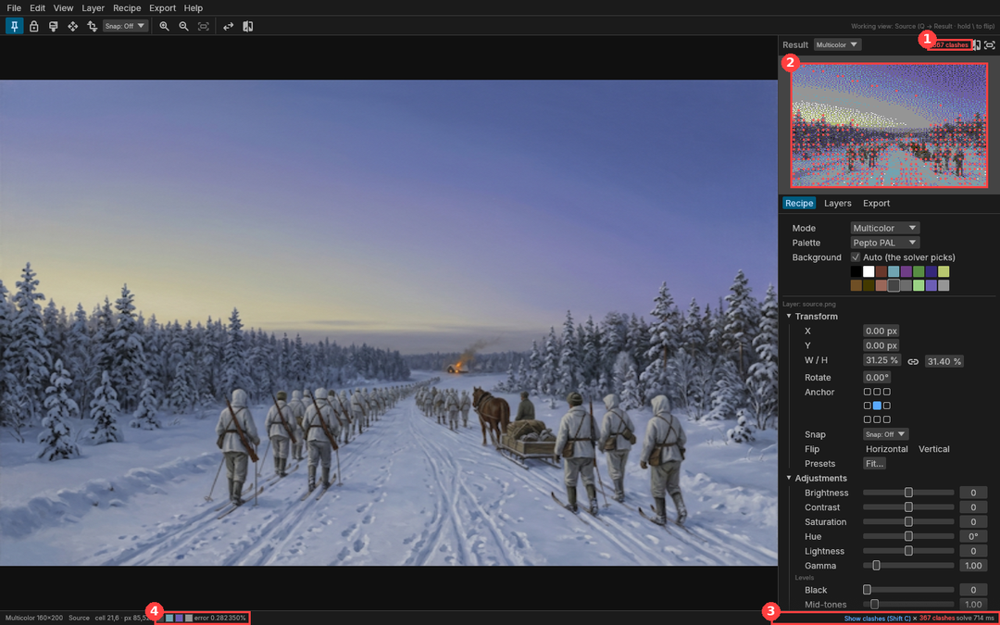

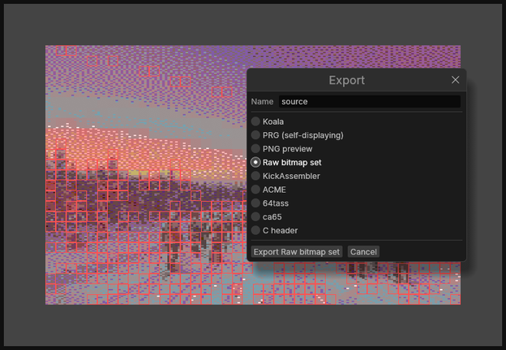

**Fix:**
- Rename the number to what it measures, e.g. "Colour-limited cells: 367" or a quality score. Show it in neutral text.
- Keep red for things that block export.
- Default the dots on the result panel to off.
- Make the overlay a continuous heatmap of per-cell error (UX §14 open question 3: continuous is the answer).

### M2 — Keyboard shortcuts stop working after you touch any control

After typing into the W field (or dragging a slider), `R` did not switch to the Region tool. It worked again only after clicking the empty canvas surround — and with the default Pin tool, a click on the picture itself pins a cell (C4).

**Likely cause:** `shell/mod.rs:534` gates every bare-key shortcut on `ctx.egui_wants_keyboard_input()`, which stays true while a slider or DragValue keeps focus.

**Fix:**
- Drop focus on `Enter` and at drag end.
- Block shortcuts only while a real text field is being edited.
- `Esc` should always return focus to the canvas (Figma behaviour).

### M3 — Browser-reserved shortcuts

Chrome does not let a page intercept `Ctrl/Cmd T`, `Ctrl/Cmd N`, `Ctrl/Cmd Shift N` or `Ctrl/Cmd W`. In the browser build, Transform (`Cmd T`) opens a new tab, New Layer from File (`Shift Cmd N`) opens an incognito window, and a slip onto `Cmd W` closes the tab and the unsaved project (C3).

This is known browser behaviour outside an installed PWA or fullscreen keyboard lock; Playwright cannot reproduce it.

**Fix:**
- In the wasm build, show and bind alternatives (Transform is already `S`; New Layer could be `Shift Cmd L` or `Alt Cmd N`).
- The menus must show the binding that actually works there.

### M4 — Export is a tab with one button and a dialog of nine radios

The Export tab contains only "Export… Ctrl+E". The dialog mixes C64 files, a PNG preview and five assembler dialects in one flat list. Problems:
- No description of what each produces: file names, extensions or size.
- One format per export.
- The primary button looks like Cancel.
- `Esc` does not close it.
- Keyboard shortcuts act on the app behind it: `Q` and `Shift C` switched the view and the overlay while it was open.

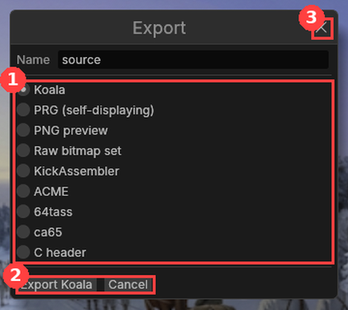

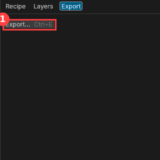

**Benchmark:** Figma's Export section lives in the properties panel. It is a list of export rows (format, scale, suffix) with **+** to add more and one Export button that writes them all.

**Fix:**
- Make the Export tab that panel: rows of *format · options · file name preview with size*, **+** to add a row, and one primary **Export** button. `Shift Cmd E` re-runs it, so the Makefile case gets a visible definition.
- Group the formats: *C64 files* (Koala `.kla`, PRG), *Source code* (KickAssembler, ACME, 64tass, ca65, C header), *Preview* (PNG).
- `Esc` closes any dialog.

### M5 — The Recipe tab is one long form, in the wrong order

The dock's form runs Mode/Palette/Background (project-wide) → a 9 px "Layer: source.png" label → Transform → Adjustments (with curves) → Mask → Dither recipe → Colour fitting → Advanced, all expanded. The dither method — the setting this product is about — is about three screens down. Project-level and layer-level settings are separated only by that tiny label.

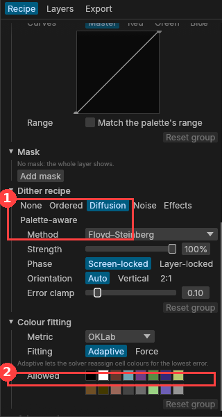

**Benchmark:** Figma's right panel is contextual and short, with collapsed sections for rarely used properties. Photoshop separates Properties from Adjustments.

**Fix:**
- Order the groups by use: **Dither recipe → Colour fitting → Adjustments → Transform → Mask**.
- Collapse Transform and Mask by default and remember open/closed per user.
- Move Mode, Palette and Background into the Result header row (the Mode dropdown is already there, so it is duplicated today).
- Give the layer section a real header: layer thumbnail + name.

### M6 — Transform values are in units nobody thinks in

- W/H are a percentage of the *source* image: 31.25 % means "fills the screen".
- The first layer opens at 31.25 % × 31.40 % with the chain *linked* — so the "uniform" layer is not uniform.
- X/Y are the top-left corner while the anchor shows the centre.
- The anchor picker is nine 8 px outline squares.
- Flip Horizontal/Vertical look like plain labels, not toggles.
- The common presets hide behind "Fit…".

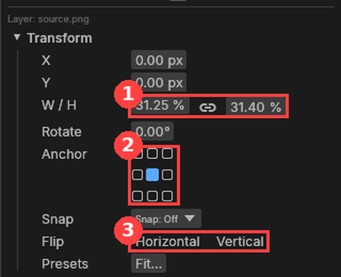

**Benchmark:** Figma shows X, Y, W, H in pixels, rotation in degrees, and a constrain-proportions toggle.

**Fix:**
- Show W/H in C64 pixels (160 × 100 reads instantly), with % as a secondary readout.
- Open new layers with a uniform scale and say so ("Fit width").
- Make the presets visible segmented buttons: *Fit · Fill · 1:1 · 2:1*.
- Make flip two icon toggles.
- Make the anchor a proper 3 × 3 control at about 16 px.

### M7 — The first Region stroke makes an empty region

`R` then a drag created "Region 1" but nothing showed on the canvas. The Region brush inherited **Subtract** from the earlier mask brush (`X`), so the stroke removed nothing from an empty region. The dock then replaced the layer's recipe with the region's, with no way back except clicking elsewhere.

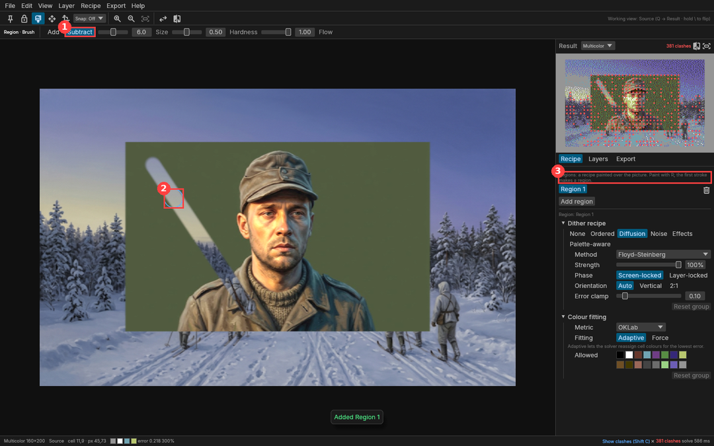

**Fix:**
- Keep tool options per tool.
- The first stroke of a new region is always Add.
- Draw the region outline in its `region` colour as soon as it exists.
- Give the dock a breadcrumb: "Region 1 ‹ source".

### M8 — Mask mode shifts the layout and its options bar is hard to read

Entering mask mode inserts an options bar that pushes the whole UI, including the result panel, down 28 px. The bar breaks the app's own conventions:
- Labels sit *after* their controls ("6.0 Size"), the opposite of the Recipe tab.
- Four icon-only buttons have no visible labels: invert, clear, fill and load.
- "From alpha" and "Alone" are cryptic.

The brush starts in Add on a full mask, so the first stroke does nothing visible.

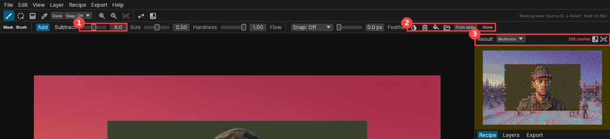

**Benchmark:** Photoshop's options bar is always present and changes contents per tool, so nothing jumps.

**Fix:**
- Reserve the options row permanently; show the current tool's options, or the transform readout, in it.
- Put labels before controls.
- Give icons text, or at least tooltips with names.
- Start a new mask from the user's choice — "Reveal all / Hide all", as Photoshop does — so the first stroke always shows.

### M9 — Backspace deletes the selected layer silently

With focus anywhere that isn't a text field, `Backspace` removed the portrait layer. There was no toast and no confirmation. Undo did restore it.

**Fix:**
- Show a toast "Deleted layer 'source' · Undo".
- Only delete when the Layers panel or the canvas has focus.

### M10 — The empty state is not actionable

The canvas says "Open an image or a .convert64 project · File › Open… (Ctrl+O), or drop a file here", with no button. Clicking the text does nothing. The tools, zoom and Snap are enabled with no document. The dock text "Open an image (Ctrl+O) to see the recipe." is about 1.6:1 against its background (see screenshot under C4).

**Fix (UX.md §5 already specifies it):**
- One primary **Open image…** button.
- A "Try a sample picture" link that opens the `title` fixture.
- Disable the tools until a picture is open.

### M11 — Hint and secondary text fails contrast

Measured from the screenshots (dark theme):

| Text | Contrast | WCAG 1.4.3 AA |
|---|---|---|
| Hint lines ("No mask: the whole layer shows.", "Adaptive lets the solver…", the "Layer:" label, the working-view hint top-right) | about 2.7:1 | needs 4.5:1 — fails |
| Empty-dock text | about 1.6:1 | fails |

Several of these are also about 9–10 px.

**Fix:**
- Raise egui's `weak_text_color` in `theme/generated.rs` (through the Figma `Visuals` variables) to at least 4.5:1 on `panel_fill` in both themes.
- Set hint text no smaller than egui's `Small` style at 11 px.

---

## Minor and polish

| # | Finding | Fix |
|---|---|---|
| m1 | *Fit* fills the canvas edge to edge, with no pasteboard margin, so handles sit on the viewport edge | Fit leaves 4–6 % padding, as Figma's zoom-to-fit does |
| m2 | Result view opens at 2× in a canvas that fits 3× | Open Result at the largest integer zoom that fits |
| m3 | Transform handles are drawn in Result mode (UX §4.1: Source only) | Hide them in Result mode |
| m4 | Status bar: "error 0.282350%" — the error value and the zoom run together; swatches have no labels | Separators, fixed-width numerals, a label on the cell colours |
| m5 | Menus show "Ctrl+Equals", "Ctrl+Minus", "Ctrl+Quote"; on/off items look the same as a hovered item; "Hide Dock" never becomes "Show Dock"; "Ghost of the Other Image"; the Recipe menu has one disabled item; Edit has only Undo/Redo | Symbol names (`Ctrl =`), check marks for toggles, Show/Hide labels, "Overlay the source", drop or fill the Recipe menu, add Copy/Paste recipe |
| m6 | The dither family control wraps "Palette-aware" onto its own line | A dropdown for the family, or a two-row segmented control |
| m7 | Layer row: the recipe badge and opacity are clipped at the right edge (light theme); no lock icon or recipe subtitle (UX §5); the bottom strip is unlabelled icons; two files named `source.png` became "source" and "source.png" | Wrap or hide the opacity column, add the subtitle, add tooltips, name layers consistently (file stem, with a number on clash) |
| m8 | At 1024 × 640 the form gets about 300 px under the fixed result | Let the result panel collapse to a 160 × 100 strip below 800 px height (UX §14 Q1) |
| m9 | Brightness moves about 1.5 units per pixel, so fine adjustment needs the number field | Shift-drag for fine steps (Figma/PS convention), scrubbable labels |

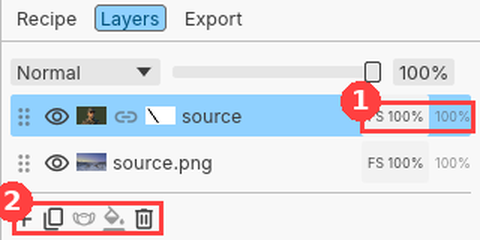

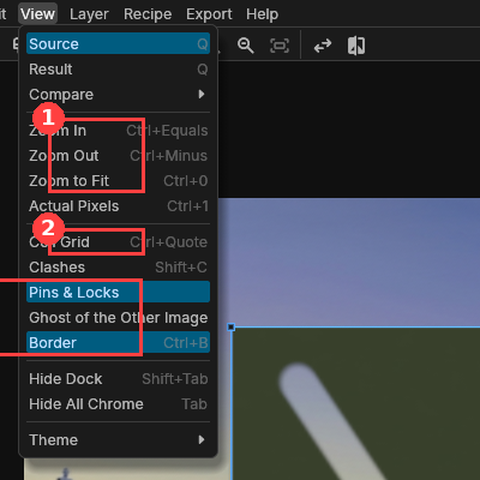

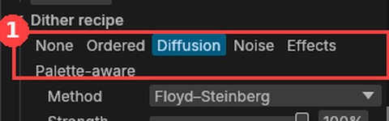

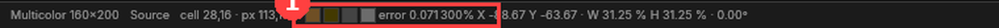

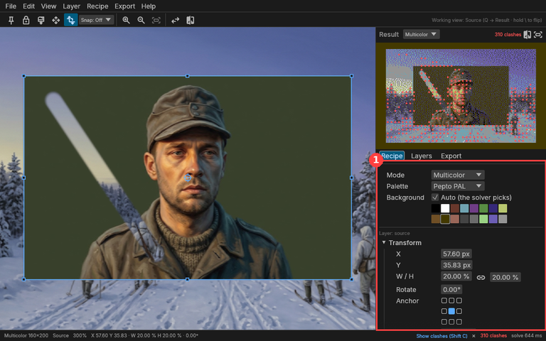

---

## What already works well

- **Live result.** Every change re-solves within a second, and the result panel is always visible. No Convert button, as UX.md §2 promises.
- **Changed-value dots** on modified controls, with the group heading highlighted (Lightroom/Affinity convention).
- **The cell right-click menu:** Pin colours, Lock, Clear, Jump to worst neighbour, Copy cell colours.
- **Tooltips name their shortcuts** ("Region (R)", "Compare: Off (, cycles · hold \ to flip)").
- **Toasts** for added layers, pins and regions, with clear wording.
- **Undo** reverted a move and a layer delete correctly.
- **Typed values** in fields apply on `Enter` and scale about the anchor.
- **Theme follows the OS.** Light and dark are both complete.

## Recommended order

1. **Before any user test (a few days):**
   - C1 transform handles (one-line cause).
   - C2 `Tab` trap.
   - C4 default tool.
   - M2 shortcut focus (one-line cause).
   - M9 delete toast.
   - m1 fit margin.
2. **Trust and data (about a week):**
   - C3 autosave, restore and direct download.
   - M1 clash semantics and colour.
   - M3 browser key bindings.
   - M11 contrast tokens, through Figma variables, then `cargo xtask tokens`.
3. **Panel design (Figma first, then code):**
   - M5 panel order and split.
   - M6 transform units and controls.
   - M4 Export panel.
   - M8 options bar.
   - M7 region flow.
   - M10 empty state.
4. **Polish:** m2–m9.
5. **Then run the UX.md §14 user test** (5 users, the `title` tasks), with time to first legal export as the headline measure.

## Limits of this review

- Headless Chromium on Linux (`Ctrl`, not `Cmd`), driven by synthetic input. No trackpad, no touch, no high-DPI. The native build was not tested.
- C3's save behaviour and M3's reserved keys must be confirmed in desktop Chrome and Safari.
- Expert review, not user research: it finds conformance and interaction defects well, and says little about whether the concepts (recipes, regions, pins) make sense to the three user types in UX.md §1.
- Screenshots: `docs/research/usability-2026-10-13/`. The raw captures and the Playwright driver can be regenerated from the steps above.
